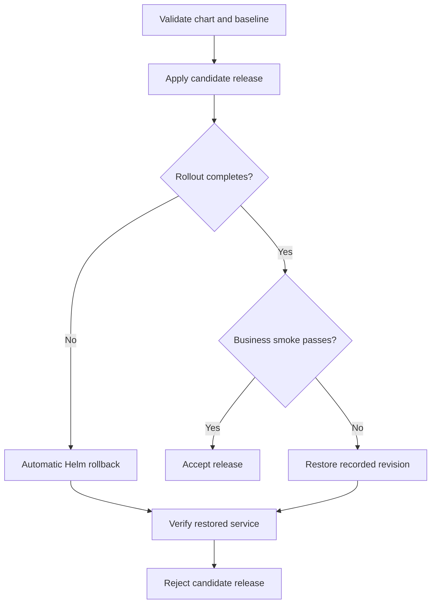

# Kubernetes Safe Release Pipeline

[](https://github.com/jdj333/kubernetes-safe-release-pipeline/actions/workflows/ci.yml)

A runnable Kubernetes release laboratory: deploy a healthy application, reject a deliberately broken release, recover to a verified revision, and prove that a subsequent release succeeds.

This project demonstrates deployment reliability and incident recovery for platform engineering, DevOps, and SRE work. It runs on **kind**, without cloud credentials, a paid cluster, or a container registry account.

## What it demonstrates

| Capability | Implementation | Evidence |
| --- | --- | --- |
| Safe rolling updates | Two replicas, `maxUnavailable: 0`, `maxSurge: 1`, minimum ready time, progress deadline | Healthy replicas remain available during the readiness fault |
| Distinct health signals | `/startupz`, `/readyz`, `/healthz` | Tests separate slow startup, unready state, and liveness |
| Graceful shutdown | Loopback drain endpoint, five-second preStop, SIGTERM handling, bounded request completion | A real process test sends SIGTERM during an accepted request |
| Functional release gates | In-cluster smoke Job checks Service DNS, readiness, version, and a business endpoint | A ready but broken release is rejected |
| Recovery | Helm automatic rollback plus explicit rollback after smoke failure | Each rollback is followed by rollout and business checks |
| Operational practice | Failure overlays, diagnostic capture, recovery runbook | CI exercises manual and automatic recovery |

## Run locally

Prerequisites: Docker with at least 4 CPUs and 6 GB memory available, Bash, Make, Python 3.12+, kubectl 1.35.x, **Helm 4**, and kind 0.33.0. Docker Desktop works on macOS; use WSL2 on Windows. The CI tool versions are Helm 4.3.1, kind 0.33.0, and kubectl 1.35.8. The kind node image is pinned by digest.

```bash
git clone https://github.com/jdj333/kubernetes-safe-release-pipeline.git
cd kubernetes-safe-release-pipeline
python3 -m venv .venv
source .venv/bin/activate
python3 -m pip install -r requirements-dev.txt
make test lint
make cluster
make build
make deploy
make smoke
```

The `safe-release:local` image is built from this repository and loaded into all kind nodes. No pre-published application image is required. The scripts explicitly select context `kind-safe-release-demo`, namespace `safe-release-demo`, and release `safe-release`; they do not deploy to your current context. `make cluster` can change your kubeconfig's current context as part of kind's normal behavior.

Run all failure and recovery scenarios:

```bash
make drill
```

The drill performs a healthy install, a manual readiness failure and recovery, an automatic readiness rollback, a business failure and rollback, and a healthy upgrade to version `1.1.0`. It leaves the demo healthy. Expect several minutes for the intentional rollout timeouts.

Inspect the app:

```bash
kubectl --context kind-safe-release-demo -n safe-release-demo \
  port-forward service/safe-release 8080:80
# In another terminal:
curl http://localhost:8080/version
curl http://localhost:8080/api/order
```

`make diagnose` saves lab evidence in `artifacts/`. `make clean` deletes only the named demo cluster and its workloads.

## Release and recovery flow



A failed candidate returns a nonzero exit status even after successful recovery. Helm 4 uses `--rollback-on-failure`; Helm 3's `--atomic` is intentionally not used. The wrapper also waits for Deployment rollout completion, then verifies business behavior. A Kubernetes progress deadline reports a stalled rollout; it does not initiate recovery by itself.

## Repository guide

| Path | Purpose |
| --- | --- |
| [`app/`](app/) | Dependency-free Python HTTP application and smoke client |
| [`charts/safe-release/`](charts/safe-release/) | Helm chart, configuration schema, Deployment, Service, and PDB |
| [`scripts/deploy.sh`](scripts/deploy.sh) | Candidate rollout and failure handling |
| [`scripts/drill.sh`](scripts/drill.sh) | Executable recovery exercise |
| [`examples/`](examples/) | kind topology and two deliberate fault overlays |
| [`tests/`](tests/) | Real HTTP and process tests, rendered-chart safety checks |
| [`docs/recovery.md`](docs/recovery.md) | Manual incident diagnosis and recovery procedure |
| [`docs/design.md`](docs/design.md) | Design choices, tradeoffs, and production adaptation |

## CI and scope

GitHub Actions runs the application tests and chart checks, builds the image, creates a three-node kind cluster, executes the complete recovery drill, uploads evidence, and removes the cluster. The workflow uses a read-only repository token and requires no repository secrets. It never deploys to AWS, Azure, GCP, or a production cluster.

This is a deployment laboratory. Python's standard-library HTTP server, synthetic transactions, and configuration-driven faults keep the exercise understandable. Production services need their own HTTP stack, identity, ingress, resource sizing, security controls, and business-specific release gates. A successful small smoke sample is not an availability SLO or proof of zero downtime.
